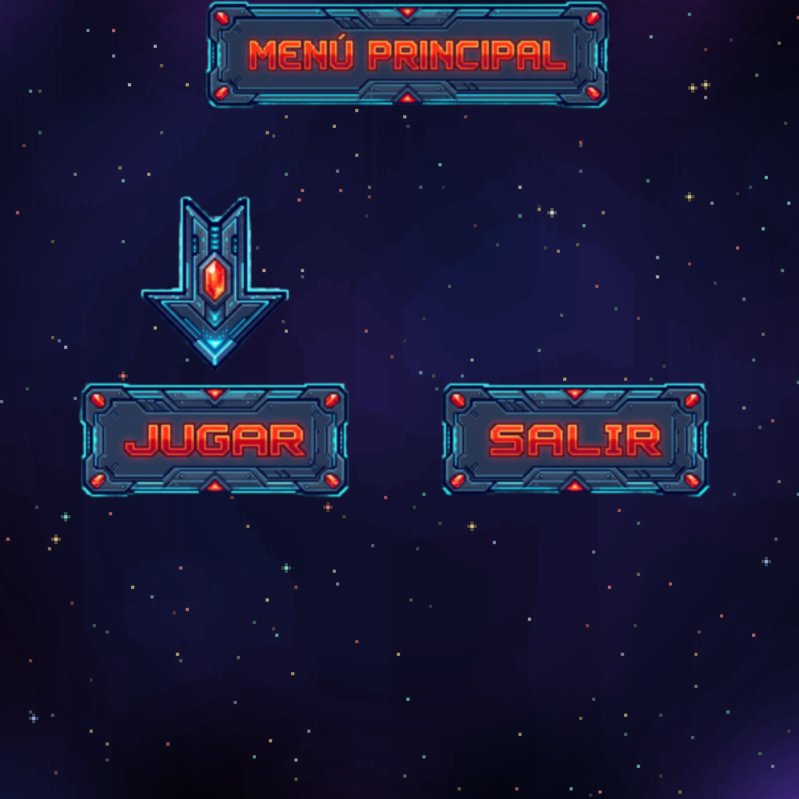
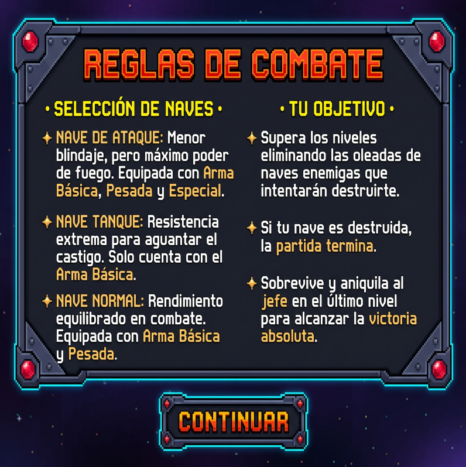
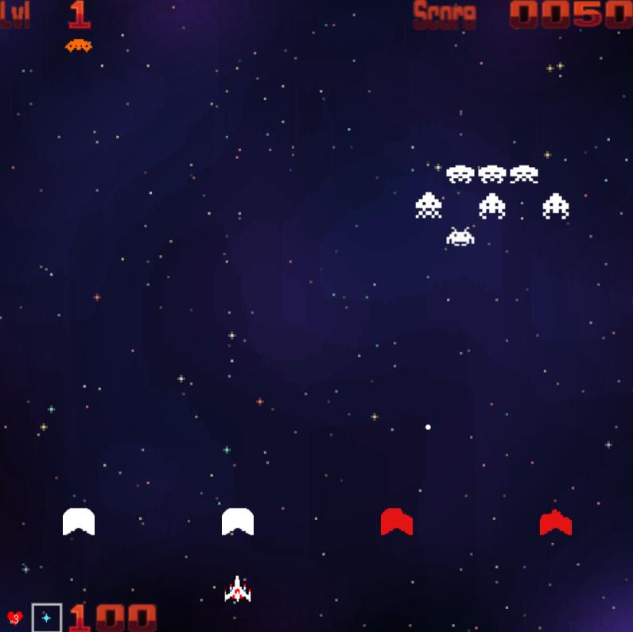

# 🚀 Zathura Game

Proyecto de la materia **Objetos 1** (UNQ). Consiste en el desarrollo del juego **Zathura**, implementado en su totalidad con el lenguaje y framework **Wollok**.

## Descripción

Zathura Game es un videojuego de disparos en el espacio, estilo arcade clásico (Space Invaders / Galaga). Enfrentate a oleadas implacables de alienígenas 👾, elegí tu nave para definir tu estrategia, cada una contara con un arsenal de armas distintas, demuestra tus habilidades de Gamer 🕹️ para alcanzar la victoria absoluta🏅.

## Menus

### Todos los menus se manejan con las siguientes Teclas.

### Este es el menu Principal 

### Las reglas del juego: 

## Sistema De Niveles

Sistema de Oleadas y Niveles: Progresión dinámica a través de niveles con dificultad creciente hasta llegar al enfrentamiento final.

Modo Cooperativo / Multijugador: Compatible para 1 o 2 jugadores simultáneos en pantalla. Tené en cuenta que en caso de jugar de dos, la dificultad sera mayor!⚠️⚠️⚠️

Sistema de Puntuación: Destruye diferentes tipos de enemigos (Básicos, Especiales, Heavys y el escurridizo OVNI de bonificación) para sumar puntos y batir récords.

## Como funciona cada nivel?

Cada nivel tendra una cantidad de oleadas que la dificultad de cada una aumentara conforme se vayan eliminando y respecto de la dificultad elegida por el jugador o jugadores, al eliminarlas, te enfrentaras al Boss de dicho nivel, que sera un cangrejo.

### Oleadas

- Las oleadas del nivel 1 estan conformadas por enemigos básicos que aguantan apenas un disparo, y su daño es bajo.
- Las oleadas del nivel 2 ya contienen enemigos Heavy's, los cuales tienen un aumento de vida y su disparo te quitara una vida entera.

Que características tienen los cangrejos por las cuales es un Boss?

- Muchisima Vida.
- Disparo Especial.
- Movimiento más Rápido

# Dificultad

### Que impacto tiene la seleccion de la dificultad en el juego?

- TODOS los enemigos se moveran más rápido.
- El daño de TODOS los enemigos sera mayor.
- Los puntos recibidos por eliminar a los enemigos sera mayor.

# Puntajes.

### Sistema de puntos que otorgan los enemigos al ser eliminados.

# Naves

## Modo un Jugador o modo cooperativo 2 Jugadores.

### Seleccion de Cantidad De Jugadores.

## Estos los controles de la nave para un jugador y para el modo cooperativo de 2 jugadores

## Estas son las naves que se pueden elegir.

## Mecanicas de las Armas segun la Nave.

### Nave Normal
- Arma Básica: Disparo Normal.
- Arma Pesada de Nave Normal: Disparo Doble.

### Nave De Ataque
- Arma Básica: Disparo Normal.
- Arma Pesada: Disparo Triple
- Arma Especial: Disparo único pero con muchisimo daño.

### Nave Tanque

- Arma Básica: Disparo Normal.

### Imagenes In Game

## Tecnología utilizada.

- **Wollok** (Wollok Game)

## Integrantes

- Muñoz Damian (emikdev)
- Marcos Correia (Marcos-Correia17)
- Joaquin Paniagua (joaquinjesus1234)
- Nahuel Romero (NRomeroDev)

