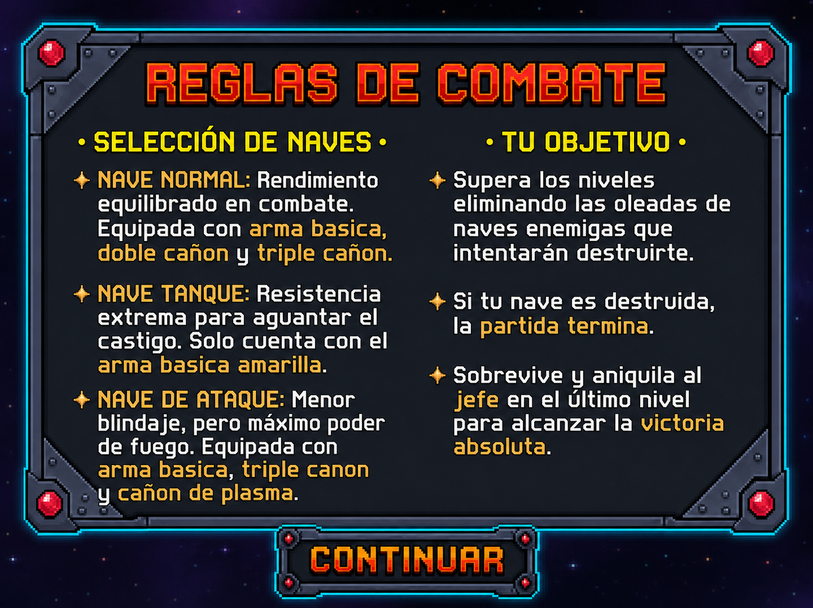
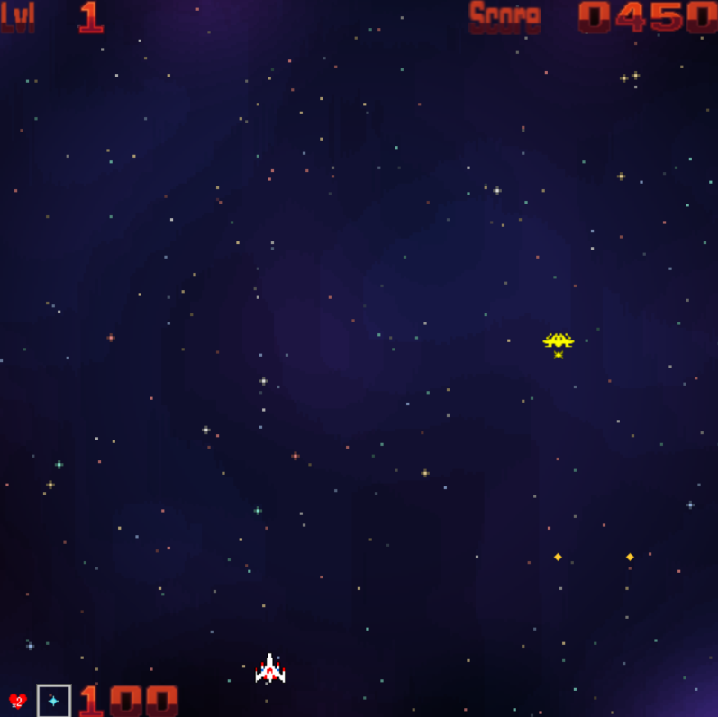
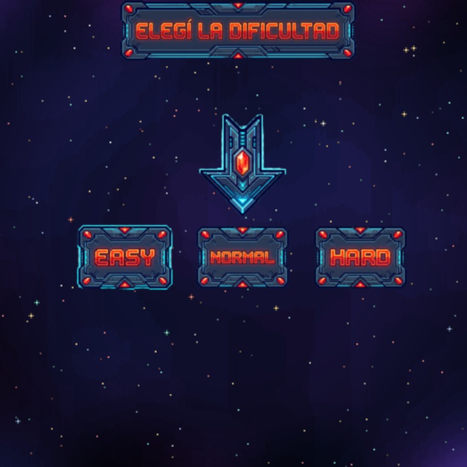
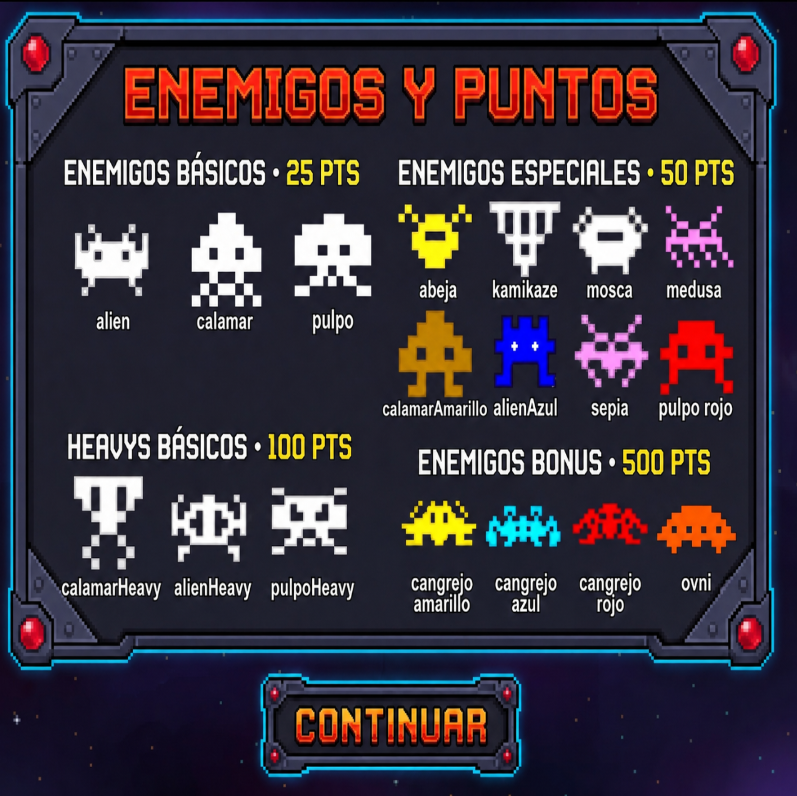
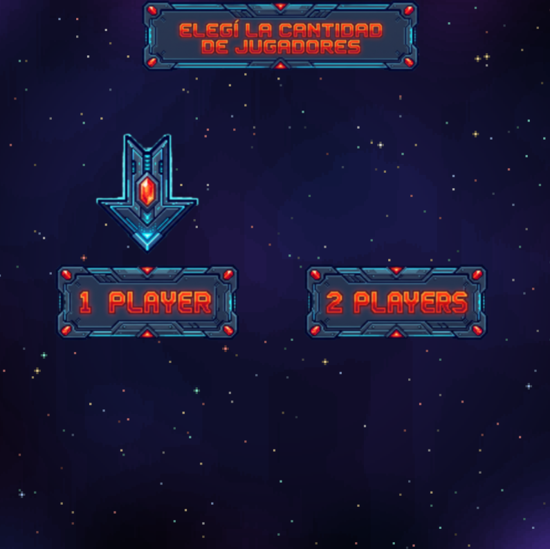
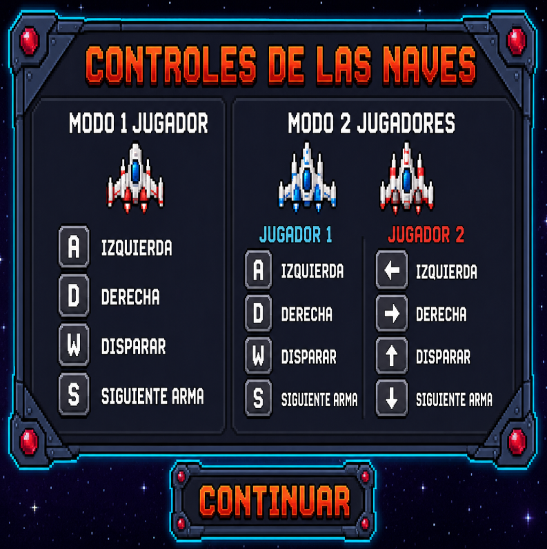
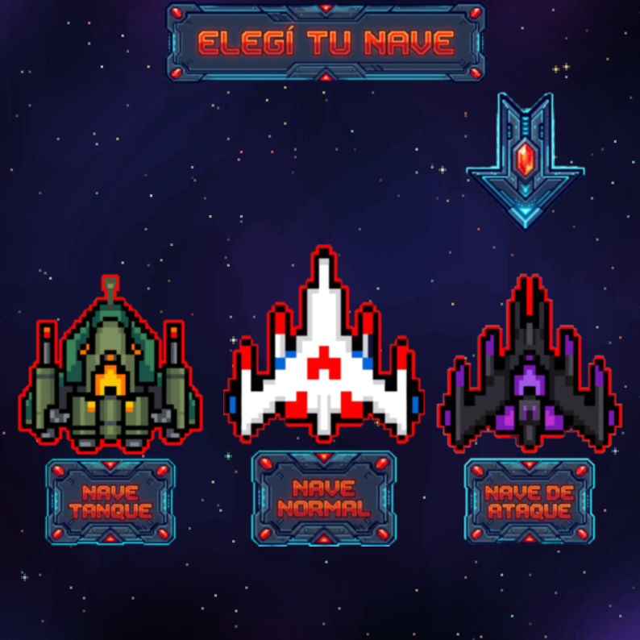

# 🚀 Zathura Game

Proyecto de la materia **Objetos 1** (UNQ). Consiste en el desarrollo del juego **Zathura**, implementado en su totalidad con el lenguaje y framework **Wollok**.

## Descripción

Zathura Game es un videojuego de disparos en el espacio, estilo arcade clásico (Space Invaders / Galaga). Enfrentate a oleadas implacables de alienígenas 👾, elegí tu nave para definir tu estrategia —cada una contará con un arsenal de armas distintas— y demostrá tus habilidades de *gamer* 🕹️ para alcanzar la victoria absoluta 🏅.

## Menús

### Todos los menús se manejan con las siguientes teclas

### Este es el menú principal

# Las reglas de combate

## Sistema de niveles

- **Sistema de oleadas y niveles:** progresión dinámica a través de niveles con dificultad creciente hasta llegar al enfrentamiento final.
- **Modo cooperativo / multijugador:** compatible para 1 o 2 jugadores simultáneos en pantalla. ¡Tené en cuenta que, en caso de jugar de a dos, la dificultad será mayor! ⚠️⚠️⚠️
- **Sistema de puntuación:** destruí diferentes tipos de enemigos (Básicos, Especiales, *Heavys* y el escurridizo OVNI de bonificación) para sumar puntos y batir récords.
- **Cantidad de niveles:** 4.

## ¿Cómo funciona cada nivel?

Cada nivel tendrá una cantidad de oleadas cuya dificultad aumentará conforme se vayan eliminando y según la dificultad elegida por el jugador o los jugadores. Al eliminarlas, te enfrentarás al *Boss* de dicho nivel, que será un cangrejo.

### Oleadas

- Las oleadas del nivel 1 están conformadas por enemigos básicos que aguantan apenas un disparo, y su daño es bajo.
- Las oleadas del nivel 2 ya contienen enemigos *Heavy*, los cuales tienen un aumento de vida y su disparo te quitará una vida entera.
- Y así sucesivamente aumentará la dificultad y cambiarán los enemigos (no hago más *spoiler* 👾👾👾).

### Imagen In Game

¿Qué características tienen los cangrejos por las cuales son un *Boss*?

- Muchísima vida ☠️
- Disparo especial ☠️☠️
- Movimiento más rápido ☠️☠️☠️

### Imagen In Game

# Dificultad

### ¿Qué impacto tiene la selección de la dificultad en el juego?

- TODOS los enemigos se moverán más rápido.
- El daño de TODOS los enemigos será mayor.
- Los puntos recibidos por eliminar a los enemigos serán mayores.

# Puntajes

### Sistema de puntos que otorgan los enemigos al ser eliminados

# Naves

## Modo un jugador o modo cooperativo de 2 jugadores 🤝

### Selección de cantidad de jugadores

## Estos son los controles de la nave para un jugador y para el modo cooperativo de 2 jugadores

## Estas son las naves que se pueden elegir

## Mecánicas de las armas según la nave

### Nave normal
- Arma básica: disparo normal.
- Arma cañon doble: disparo doble.
- Arma cañon triple: disparo triple.

### Nave de ataque
- Arma básica: disparo normal con un x2 de velocidad y un x3 de daño
- Arma triple cañon: disparo triple.
- Arma cañon de plasma: disparo único pero con muchísimo daño.

### Nave tanque

- Arma básica amarilla: disparo normal con un x3 de daño

## Tecnología utilizada

- **Wollok** (Wollok Game)

## Integrantes

- Muñoz Damián (emikdev)
- Marcos Correia (Marcos-Correia17)
- Joaquín Paniagua (joaquinjesus1234)
- Nahuel Romero (NRomeroDev)